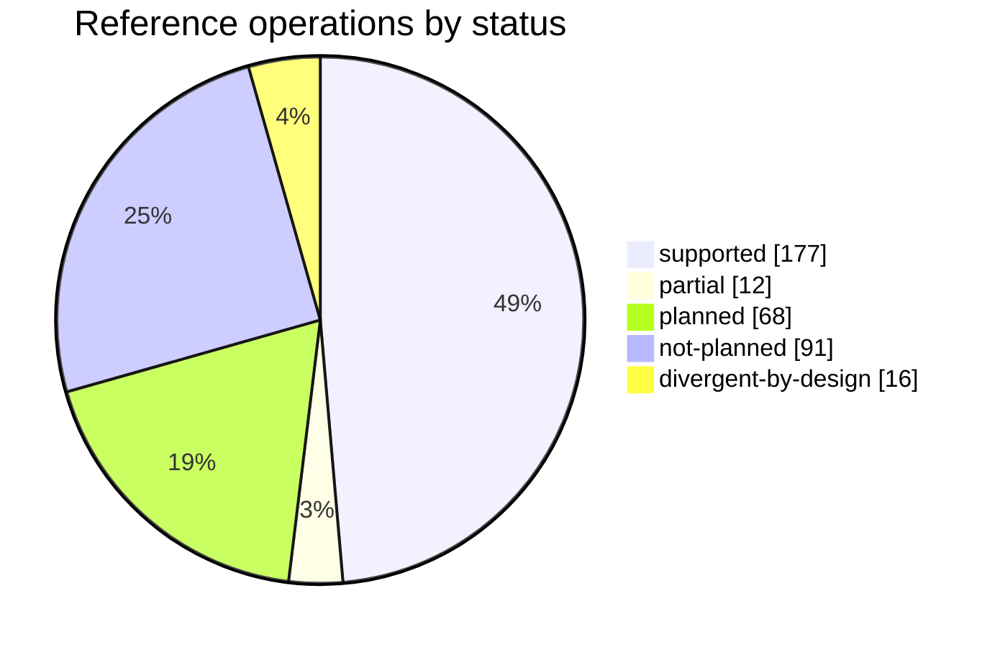
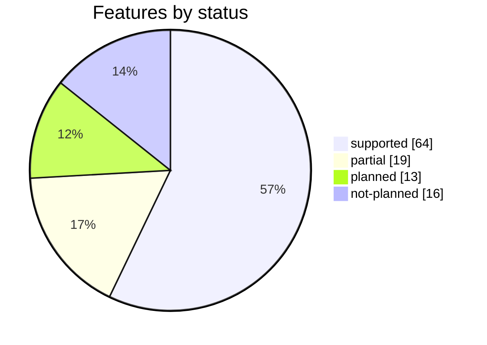

<!-- Generated by `go run ./cmd/conformance coverage`. Do not edit; edit docs/coverage/overlay.json or docs/coverage/features/*.json. -->

# What Tinyfin does and does not do

Whole-backend coverage of Jellyfin 12.2.0 (jellyfin/jellyfin:12.2 /api-docs/openapi.json), computed from the reference's OpenAPI document,
the routes Tinyfin registers and the contract scenarios that pass in `docs/contract/baseline.json`.
How to read and edit this: [`docs/coverage/README.md`](coverage/README.md). Machine-readable copy: [`docs/coverage/status.json`](coverage/status.json).

| Legend | |
|---|---|
| ✅ supported | works; for routes: registered, and the contract has a passing scenario unless marked *no scenario* |
| 🟡 partial | exists with known limits (see notes) |
| 🗓️ planned | intended, not built |
| ⛔ not-planned | deliberately out of scope or not on any roadmap |
| ↔️ divergent-by-design | behaves differently from the reference on purpose |

## Totals

| Measure | Value |
|---|---|
| Reference operations (OpenAPI 12.2.0) | 364 |
| Registered by Tinyfin | **205** (56%) |
| Registered **and** a passing contract scenario | **173** (48%) |
| Called by the official web client (docs/11) and registered | 135 of 165 (82%) |
| Routes Tinyfin serves that the OpenAPI document lacks | 36 (legacy aliases the web client needs, `/socket`, HLS) |
| Non-route features tracked | 112 (✅ 64 · 🟡 19 · 🗓️ 13 · ⛔ 16) |

### Routes by status

✅✅✅✅✅✅✅✅✅✅🗓️🗓️🗓️🗓️⛔⛔⛔⛔⛔↔️ ✅ 177 · 🟡 12 · 🗓️ 68 · ⛔ 91 · ↔️ 16

### Non-route features by status

✅✅✅✅✅✅✅✅✅✅✅✅🟡🟡🟡🗓️🗓️⛔⛔⛔ ✅ 64 · 🟡 19 · 🗓️ 13 · ⛔ 16

## HTTP API by controller group

Registered = Tinyfin serves the route. Verified = registered with a passing contract scenario.

| Group | Ops | Registered | Verified | Progress | Status |
|---|---|---|---|---|---|
| [Collections, playlists and mixes](coverage/api-collections-playlists.md) | 21 | 21 (100%) | 21 (100%) | ✅✅✅✅✅✅✅✅✅✅✅✅✅✅✅✅✅✅✅↔️ | ✅ 20 · ↔️ 1 |
| [Images](coverage/api-images.md) | 40 | 11 (28%) | 7 (18%) | ✅✅✅✅✅✅🗓️🗓️🗓️🗓️🗓️🗓️🗓️🗓️🗓️🗓️🗓️🗓️🗓️🗓️ | ✅ 11 · 🗓️ 29 |
| [Library administration](coverage/api-library-admin.md) | 32 | 15 (47%) | 10 (31%) | ✅✅✅✅✅✅✅✅🗓️🗓️🗓️🗓️🗓️🗓️🗓️🗓️🗓️⛔⛔↔️ | ✅ 13 · 🗓️ 14 · ⛔ 3 · ↔️ 2 |
| [Library browsing and metadata queries](coverage/api-library-browse.md) | 58 | 47 (81%) | 43 (74%) | ✅✅✅✅✅✅✅✅✅✅✅✅✅✅✅✅🗓️🗓️🗓️🗓️ | ✅ 45 · 🟡 1 · 🗓️ 10 · ⛔ 1 · ↔️ 1 |
| [Live TV and channels](coverage/api-live-tv.md) | 43 | 4 (9%) | 3 (7%) | ✅🟡⛔⛔⛔⛔⛔⛔⛔⛔⛔⛔⛔⛔⛔⛔⛔⛔⛔⛔ | ✅ 3 · 🟡 1 · ⛔ 39 |
| [Playback, streaming and subtitles](coverage/api-playback.md) | 38 | 24 (63%) | 19 (50%) | ✅✅✅✅✅✅✅✅✅✅🟡🟡⛔⛔⛔⛔⛔⛔⛔↔️ | ✅ 19 · 🟡 3 · ⛔ 14 · ↔️ 2 |
| [Sessions, play state and realtime](coverage/api-sessions-realtime.md) | 50 | 18 (36%) | 16 (32%) | ✅✅✅✅✅✅✅🗓️🗓️🗓️🗓️🗓️⛔⛔⛔⛔⛔⛔⛔⛔ | ✅ 17 · 🟡 1 · 🗓️ 11 · ⛔ 21 |
| [System, branding, localization and plugins](coverage/api-system.md) | 47 | 30 (64%) | 26 (55%) | ✅✅✅✅✅✅✅✅✅🟡🟡🟡🗓️🗓️⛔⛔⛔⛔⛔↔️ | ✅ 21 · 🟡 6 · 🗓️ 4 · ⛔ 13 · ↔️ 3 |
| [Users, authentication and first-run setup](coverage/api-users-auth.md) | 35 | 35 (100%) | 28 (80%) | ✅✅✅✅✅✅✅✅✅✅✅✅✅✅✅✅↔️↔️↔️↔️ | ✅ 28 · ↔️ 7 |

### By OpenAPI tag (controller)

| Tag | Ops | Registered | Verified | Status |
|---|---|---|---|---|
| Artist | 3 | 3 | 3 | ✅ 3 |
| Audio | 6 | 2 | 2 | ✅ 2 · ⛔ 4 |
| Authentication | 13 | 13 | 13 | ✅ 10 · ↔️ 3 |
| Backup | 4 | 4 | 4 | ✅ 2 · 🟡 2 |
| Branding | 3 | 3 | 2 | ✅ 3 |
| Channel | 5 | 1 | 1 | ✅ 1 · ⛔ 4 |
| Collection | 3 | 3 | 3 | ✅ 2 · ↔️ 1 |
| Device | 5 | 5 | 5 | ✅ 5 |
| DisplayPreference | 2 | 2 | 0 | ✅ 2 |
| Environment | 5 | 5 | 0 | ✅ 5 |
| Filter | 2 | 2 | 2 | ✅ 1 · 🟡 1 |
| Genre | 2 | 2 | 2 | ✅ 2 |
| Image | 37 | 11 | 7 | ✅ 11 · 🗓️ 26 |
| InstantMix | 7 | 7 | 7 | ✅ 7 |
| ItemLookup | 11 | 0 | 0 | 🗓️ 11 |
| ItemUpdate | 3 | 0 | 0 | ⛔ 3 |
| Library | 34 | 26 | 23 | ✅ 25 · 🗓️ 8 · ↔️ 1 |
| LibraryStructure | 8 | 5 | 5 | ✅ 5 · 🗓️ 3 |
| LiveTv | 38 | 3 | 2 | ✅ 2 · 🟡 1 · ⛔ 35 |
| Localization | 4 | 4 | 4 | ✅ 4 |
| Lyric | 6 | 1 | 1 | ✅ 1 · ⛔ 5 |
| MediaInfo | 5 | 3 | 2 | ✅ 3 · ⛔ 2 |
| MediaSegment | 1 | 1 | 1 | ✅ 1 |
| Movie | 1 | 1 | 1 | ✅ 1 |
| MusicGenre | 1 | 1 | 1 | ✅ 1 |
| Person | 2 | 2 | 2 | ✅ 2 |
| Playlist | 11 | 11 | 11 | ✅ 11 |
| Plugin | 17 | 4 | 3 | 🟡 1 · ⛔ 13 · ↔️ 3 |
| RemoteImage | 3 | 0 | 0 | 🗓️ 3 |
| ScheduledTask | 5 | 5 | 5 | ✅ 3 · ↔️ 2 |
| Search | 1 | 1 | 1 | ✅ 1 |
| Session | 18 | 7 | 7 | ✅ 6 · 🟡 1 · 🗓️ 11 |
| Show | 4 | 3 | 2 | ✅ 3 · 🗓️ 1 |
| Startup | 7 | 7 | 0 | ✅ 6 · ↔️ 1 |
| Studio | 2 | 2 | 2 | ✅ 2 |
| Subtitle | 10 | 10 | 8 | ✅ 5 · 🟡 3 · ↔️ 2 |
| Suggestion | 1 | 1 | 1 | ✅ 1 |
| SyncPlay | 22 | 1 | 1 | ✅ 1 · ⛔ 21 |
| System | 19 | 15 | 13 | ✅ 12 · 🟡 3 · 🗓️ 4 |
| Trailer | 1 | 0 | 0 | ⛔ 1 |
| TrickPlay | 2 | 2 | 2 | ✅ 2 |
| User | 10 | 10 | 10 | ✅ 7 · ↔️ 3 |
| UserData | 8 | 8 | 8 | ✅ 8 |
| UserView | 2 | 1 | 1 | ✅ 1 · 🗓️ 1 |
| Video | 8 | 5 | 3 | ✅ 5 · ⛔ 3 |
| Year | 2 | 2 | 2 | ✅ 2 |

## Subsystems and features

| Area | Features | Progress | Status |
|---|---|---|---|
| [Browse by name and discovery](coverage/browse.md) | 6 | ✅✅✅✅✅✅✅✅✅✅✅✅✅✅🟡🟡🟡🗓️🗓️🗓️ | ✅ 4 · 🟡 1 · 🗓️ 1 |
| [Collections](coverage/collections.md) | 5 | ✅✅✅✅✅✅✅✅✅✅✅✅✅✅✅✅🗓️🗓️🗓️🗓️ | ✅ 4 · 🗓️ 1 |
| [Library types](coverage/library-types.md) | 11 | ✅✅✅✅✅✅✅✅✅🟡🟡🟡🟡🗓️🗓️⛔⛔⛔⛔⛔ | ✅ 5 · 🟡 2 · 🗓️ 1 · ⛔ 3 |
| [Item metadata and DTO fields](coverage/metadata.md) | 8 | ✅✅✅✅✅✅✅✅✅✅✅✅✅✅✅✅✅✅🟡🟡 | ✅ 7 · 🟡 1 |
| [Platform features and out-of-scope subsystems](coverage/platform.md) | 9 | ✅✅🟡🟡🗓️🗓️🗓️🗓️🗓️⛔⛔⛔⛔⛔⛔⛔⛔⛔⛔⛔ | ✅ 1 · 🟡 1 · 🗓️ 2 · ⛔ 5 |
| [Playback, streaming and transcoding](coverage/playback.md) | 16 | ✅✅✅✅✅✅✅✅✅✅🟡🟡🟡🟡🟡🗓️🗓️🗓️⛔⛔ | ✅ 8 · 🟡 4 · 🗓️ 2 · ⛔ 2 |
| [Playlists](coverage/playlists.md) | 3 | ✅✅✅✅✅✅✅✅✅✅✅✅✅✅✅✅✅✅✅✅ | ✅ 3 |
| [Sessions, WebSocket and play reporting](coverage/realtime.md) | 6 | ✅✅✅🟡🟡🟡🟡🟡🟡🟡🗓️🗓️🗓️🗓️🗓️🗓️🗓️⛔⛔⛔ | ✅ 1 · 🟡 2 · 🗓️ 2 · ⛔ 1 |
| [Library scanning](coverage/scan.md) | 24 | ✅✅✅✅✅✅✅✅✅✅✅✅✅✅✅🟡🟡🗓️⛔⛔ | ✅ 18 · 🟡 2 · 🗓️ 1 · ⛔ 3 |
| [System, configuration and operations](coverage/system.md) | 12 | ✅✅✅✅✅✅✅🟡🟡🟡🟡🟡🟡🟡🟡🗓️🗓️🗓️⛔⛔ | ✅ 4 · 🟡 5 · 🗓️ 2 · ⛔ 1 |
| [Users, authentication and parental controls](coverage/users.md) | 12 | ✅✅✅✅✅✅✅✅✅✅✅✅✅✅✅🟡🟡🗓️🗓️⛔ | ✅ 9 · 🟡 1 · 🗓️ 1 · ⛔ 1 |

## Behavior contract (derived)

The contract is what makes "supported" checkable: `go run ./cmd/conformance run` against a throwaway Tinyfin, compared with the committed baseline.

| Spec | Rules | Rules with a scenario | Scenarios | Passing |
|---|---|---|---|---|
| [admin](contract/specs/admin.md) | 44 | 42 | 11 | 11 |
| [bitmap](contract/specs/bitmap.md) | 42 | 20 | 11 | 11 |
| [browse](contract/specs/browse.md) | 29 | 29 | 15 | 15 |
| [chapters](contract/specs/chapters.md) | 26 | 26 | 5 | 5 |
| [collections](contract/specs/collections.md) | 51 | 51 | 30 | 30 |
| [devices](contract/specs/devices.md) | 13 | 13 | 6 | 6 |
| [extras](contract/specs/extras.md) | 21 | 21 | 15 | 15 |
| [images](contract/specs/images.md) | 20 | 18 | 14 | 13 |
| [items](contract/specs/items.md) | 173 | 173 | 156 | 156 |
| [misc](contract/specs/misc.md) | 7 | 7 | 3 | 3 |
| [music](contract/specs/music.md) | 82 | 82 | 14 | 14 |
| [musicvideos](contract/specs/musicvideos.md) | 26 | 26 | 17 | 17 |
| [playback](contract/specs/playback.md) | 60 | 59 | 7 | 7 |
| [playlists](contract/specs/playlists.md) | 33 | 33 | 23 | 23 |
| [playstate](contract/specs/playstate.md) | 108 | 105 | 107 | 107 |
| [policy](contract/specs/policy.md) | 19 | 18 | 8 | 8 |
| [quickconnect](contract/specs/quickconnect.md) | 26 | 26 | 23 | 23 |
| [scan](contract/specs/scan.md) | 36 | 36 | 23 | 23 |
| [search](contract/specs/search.md) | 16 | 16 | 14 | 14 |
| [startup](contract/specs/startup.md) | 25 | 23 | 3 | 0 |
| [subtitles](contract/specs/subtitles.md) | 49 | 49 | 23 | 23 |
| [trickplay](contract/specs/trickplay.md) | 11 | 11 | 10 | 10 |
| [users](contract/specs/users.md) | 190 | 190 | 195 | 195 |
| [wire](contract/specs/wire.md) | 15 | 14 | 14 | 14 |
| **total** | 1122 | 1088 | 747 | 743 |

## Biggest gaps (planned or not planned, web-client facing)

Operations the official web client mentions (docs/11) that Tinyfin does not register:

| Route | Status | Group | Notes |
|---|---|---|---|
| `DELETE /Branding/Splashscreen` | 🗓️ planned | Images | Not implemented. |
| `GET /Branding/Splashscreen` | 🗓️ planned | Images | Not implemented. |
| `POST /Branding/Splashscreen` | 🗓️ planned | Images | Not implemented. |
| `GET /Genres/{name}/Images/{imageType}` | 🗓️ planned | Images | Not implemented. |
| `GET /MusicGenres/{name}/Images/{imageType}` | 🗓️ planned | Images | Not implemented. |
| `GET /Persons/{name}/Images/{imageType}` | 🗓️ planned | Images | Not implemented. |
| `GET /Studios/{name}/Images/{imageType}` | 🗓️ planned | Images | Not implemented. |
| `POST /Items/{itemId}` | ⛔ not-planned | Library administration | Metadata editing is left to an external cataloging tool (README, 'Not a media organizer'). |
| `DELETE /Items` | 🗓️ planned | Library browsing and metadata queries | Library notification hooks and file/download endpoints are not implemented. |
| `DELETE /Library/VirtualFolders/Paths` | 🗓️ planned | Library administration | Adding, removing and updating the paths of an existing library is not implemented; a library's paths are set when it is created. |
| `POST /Library/VirtualFolders/Paths` | 🗓️ planned | Library administration | Adding, removing and updating the paths of an existing library is not implemented; a library's paths are set when it is created. |
| `POST /Library/VirtualFolders/Paths/Update` | 🗓️ planned | Library administration | Adding, removing and updating the paths of an existing library is not implemented; a library's paths are set when it is created. |
| `POST /LiveTv/Programs` | ⛔ not-planned | Live TV and channels | Out of scope for v1 (docs/01, decision D8). |
| `DELETE /Audio/{itemId}/Lyrics` | ⛔ not-planned | Playback, streaming and subtitles | Music is not cataloged (video-first scope, docs/01). |
| `POST /Audio/{itemId}/Lyrics` | ⛔ not-planned | Playback, streaming and subtitles | Music is not cataloged (video-first scope, docs/01). |
| `POST /LiveStreams/Close` | ⛔ not-planned | Playback, streaming and subtitles | Out of scope for v1 (docs/01, decision D8). Live streams belong to tuners. |
| `POST /LiveStreams/Open` | ⛔ not-planned | Playback, streaming and subtitles | Out of scope for v1 (docs/01, decision D8). Live streams belong to tuners. |
| `GET /Packages/{name}` | ⛔ not-planned | System, branding, localization and plugins | No plugin system (decisions D8, D11). |
| `DELETE /Plugins/{pluginId}` | ⛔ not-planned | System, branding, localization and plugins | No plugin system (decisions D8, D11). |
| `GET /web/ConfigurationPage` | ⛔ not-planned | System, branding, localization and plugins | No plugin system (decisions D8, D11). |
| `GET /Items/{itemId}/RemoteImages` | 🗓️ planned | Images | Not implemented; the dashboard's image editor 404s on /RemoteImages/Providers (docs/11). |
| `POST /Sessions/{sessionId}/Command` | 🗓️ planned | Sessions, play state and realtime | Remote control of other sessions is not implemented (the /socket transport exists). |
| `GET /Shows/Upcoming` | 🗓️ planned | Library browsing and metadata queries | Not implemented. |
| `POST /ClientLog/Document` | 🗓️ planned | System, branding, localization and plugins | Not implemented. |
| `POST /System/Restart` | 🗓️ planned | System, branding, localization and plugins | Not implemented; a supervisor restarts the process. |
| `POST /System/Shutdown` | 🗓️ planned | System, branding, localization and plugins | Not implemented. |

